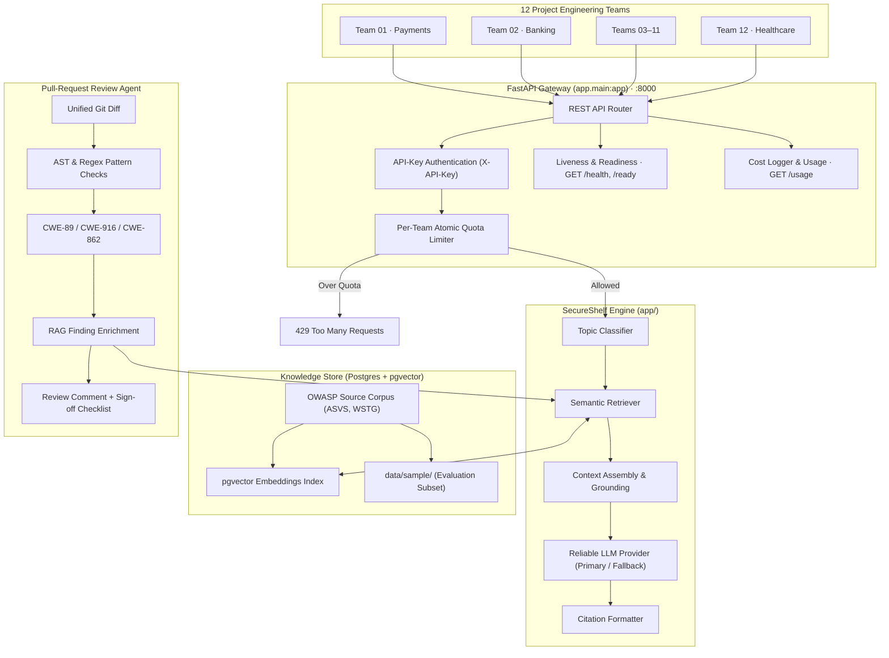
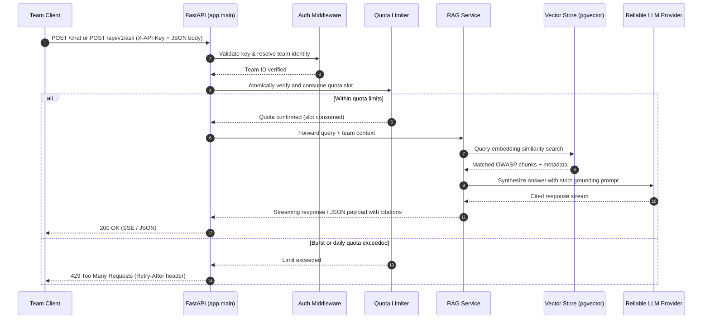
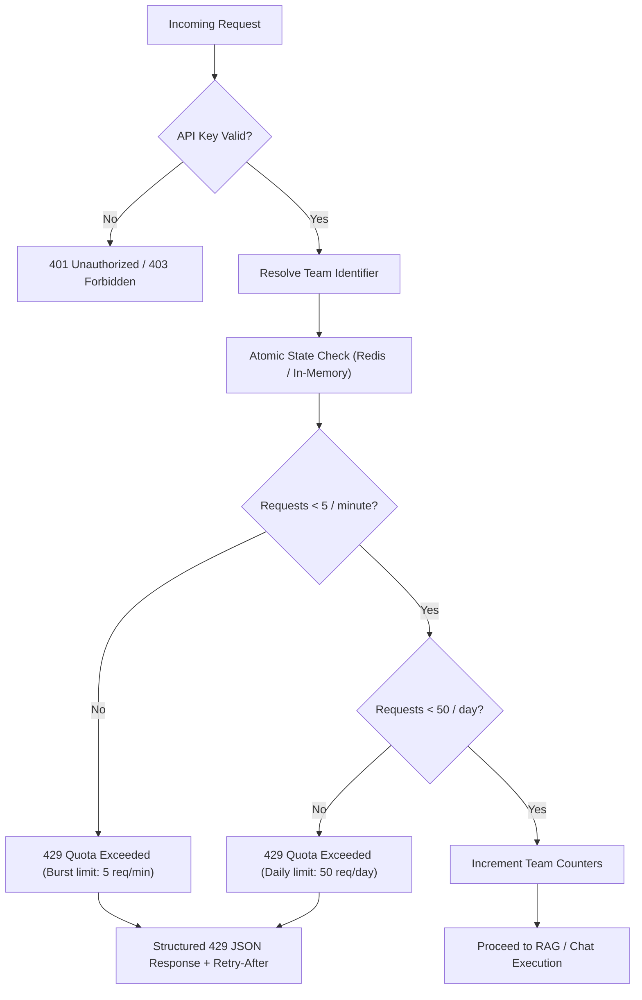
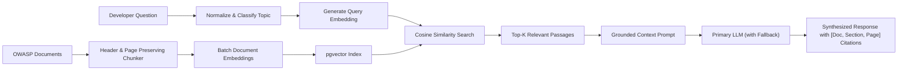
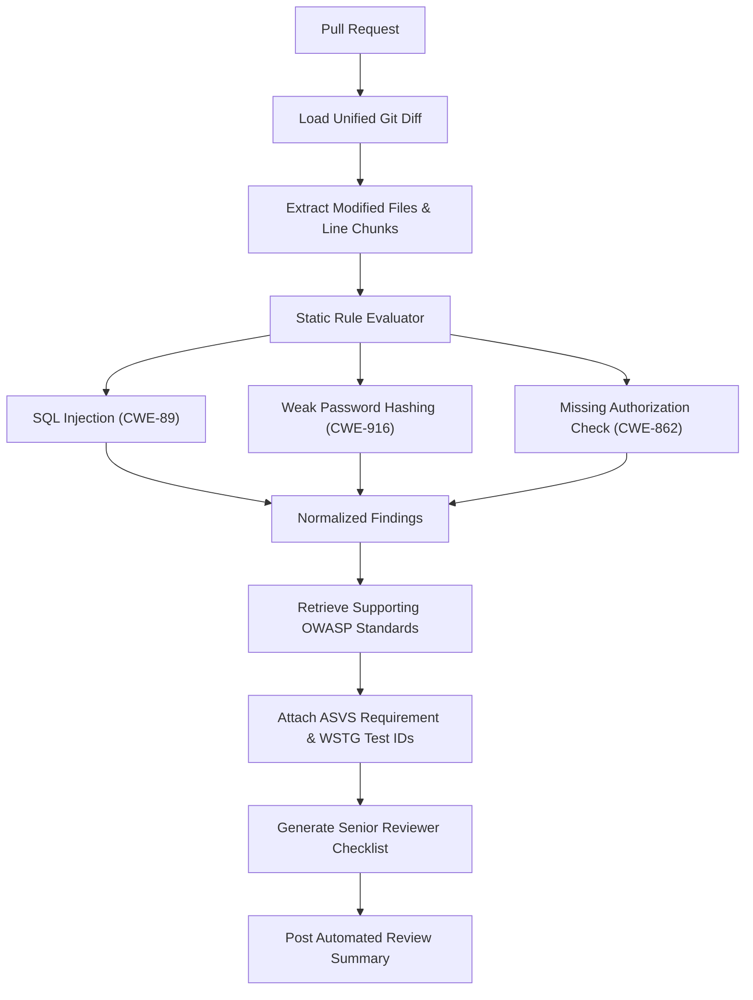
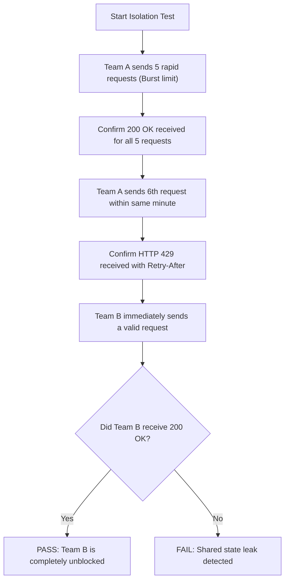

# SecureShelf

### Internal AppSec RAG Assistant · Fair-Share LLM Quotas · Pull-Request Security Reviews

> **Examate Project:** Production-grade Generative AI application providing RAG-grounded OWASP security guidance, per-team atomic quota protection, and automated pull-request security reviews for engineering organizations.

---

## Problem

Software engineering organizations struggle to apply secure-coding practices consistently across distributed product teams. Developers frequently skip consulting authoritative security documentation (such as OWASP ASVS and Cheat Sheets) due to high search friction, while shared LLM developer tooling suffers from the "noisy-neighbor" problem—where high-volume or automated requests from one team exhaust shared model quotas and starve others. SecureShelf solves this by combining retrieval-augmented generation (RAG) over verified OWASP standards, atomic per-team fair-share quota isolation, and automated pull-request diff security reviews.

## Who it is for

- **Feature Developers & Engineering Teams:** 12 project teams in Coimbatore (e.g., Payments, Banking, Healthcare) seeking immediate, grounded secure-coding answers and pre-commit diff checks without risking organization-wide rate limits.
- **Application Security (AppSec) Leads & Compliance Officers:** Security teams needing observable usage telemetry, consistent OWASP ASVS compliance verification, and standardized senior-developer review checklists.

## Signature feature

**Atomic Per-Team Fair-Share Quota Enforcement:** Independent burst (5 req/min) and daily (50 req/day) token bucket quotas keyed strictly by team identity, guaranteeing that a runaway or noisy team receives HTTP `429` responses without degrading service or depleting shared LLM token budgets for sibling teams.

## Hardest problem (my interview story)

Enforcing fair-share atomic quota limits across concurrent multi-tenant team requests without starving sibling teams or letting burst traffic bypass daily caps, while ensuring model responses remain strictly grounded with verified OWASP citations.

## Dataset

| Source | Link | Documents | Pages | Licence / terms |
|---|---|---|---|---|
| OWASP Application Security Verification Standard (ASVS v5.0 / v4.0.3) | [owasp.org/www-project-application-security-verification-standard](https://owasp.org/www-project-application-security-verification-standard/) | 1 specification | 76 | CC BY-SA 4.0 |
| OWASP Cheat Sheet Series | [cheatsheetseries.owasp.org](https://cheatsheetseries.owasp.org/) | 15 targeted sheets | 95 | CC BY-SA 4.0 |
| OWASP Web Security Testing Guide (WSTG v4.2) | [owasp.org/www-project-web-security-testing-guide](https://owasp.org/www-project-web-security-testing-guide/) | Selected controls | 120 | CC BY-SA 4.0 |

> Full data corpus lives in `data/raw/` (uncommitted raw assets, crawlers in `tools/download.py`). Curated evaluation samples are located in `data/sample/` (and `app/sample/`). See [`DATASET.md`](DATASET.md) for complete manifest and download details.

## 10 real questions

See [`docs/QUESTIONS.md`](docs/QUESTIONS.md) for the benchmark evaluation suite covering realistic developer security queries, multi-page context challenges, and out-of-scope negative assertions.

## Run it

### Local Development Setup

```bash
# 1. Create and activate virtual environment
python -m venv .venv
source .venv/bin/activate       # Windows PowerShell: .\.venv\Scripts\Activate.ps1

# 2. Install dependencies
pip install -r requirements-dev.txt

# 3. Configure environment
cp .env.example .env            # Windows: copy .env.example .env

# 4. Start the FastAPI development server
uvicorn app.main:app --reload --port 8000

# 5. Verify service health
curl http://localhost:8000/health
```

### Docker Compose (API + pgvector)

```bash
# Start PostgreSQL (pgvector 16) and SecureShelf API
docker compose up --build -d

# Verify liveness & database readiness
curl http://localhost:8000/health
curl http://localhost:8000/ready
```

## Live link

*Added in Week 2* (Target: Container deployment on Cloud Run with CI/CD).

---

## Contents

- [Highlights](#highlights)
- [System Architecture](#system-architecture)
- [Core Workflows](#core-workflows)
  - [1. Ask SecureShelf (Cited RAG & Chat)](#1-ask-secureshelf-cited-rag--chat)
  - [2. Fair-Share Quota Enforcement](#2-fair-share-quota-enforcement)
  - [3. RAG Retrieval & Grounded Generation](#3-rag-retrieval--grounded-generation)
  - [4. Pull-Request Security Review](#4-pull-request-security-review)
- [Quota Policy & Response Contract](#quota-policy--response-contract)
- [Technology Stack](#technology-stack)
- [Project Structure](#project-structure)
- [API Reference](#api-reference)
- [Testing & Verification](#testing--verification)
- [Roadmap & Milestones](#roadmap--milestones)
- [Security & Production Readiness](#security--production-readiness)
- [License and Attribution](#license-and-attribution)

---

## Highlights

| Capability | Purpose |
|---|---|
| **Team-Isolated Quotas** | Apply burst (5 req/min) and daily (50 req/day) limits independently to each team identity. |
| **Grounded AppSec Assistant** | Answer secure-coding questions using retrieved OWASP standards with exact document, section, and page citations. |
| **Streaming & Reliability** | Server-Sent Events (`POST /chat`) with exponential backoff retry and automatic secondary model fallback. |
| **Telemetry & Cost Tracking** | Append-only token and cost ledger (`logs/cost.jsonl`) with real-time daily metrics (`GET /usage`). |
| **Curated OWASP Corpus** | Structured ingestion pipeline for ASVS, Cheat Sheet Series, and WSTG guidance. |
| **PR-Diff Security Checks** | Inspect unified Git diffs for SQL injection (CWE-89), weak hashing (CWE-916), and missing authorization (CWE-862). |
| **Automated Verification** | Integration test suite proving noisy-neighbor traffic receives HTTP 429 without degrading sibling teams. |

---

## System Architecture

The architecture separates client authentication and per-team quota governance from retrieval-augmented generation and static diff analysis:



### Trust Boundaries

- **Client Boundary:** Team clients supply credentials via the `X-API-Key` HTTP header.
- **Quota Boundary:** Authentication resolves keys to a canonical team identity before quota accounting takes place.
- **Model Boundary:** Retrieved OWASP passages are treated as untrusted context, not executable system instructions. Prompts are defensively isolated against indirect prompt injection.
- **Administrative Boundary:** Quota resets, load simulations, and cross-team telemetry are restricted to authenticated administrators.
- **CI Boundary:** Unified diffs submitted for PR review are parsed strictly as data strings and never evaluated as executable code.

---

## Core Workflows

### 1. Ask SecureShelf (Cited RAG & Chat)

Developer path for submitting secure-coding queries:



### 2. Fair-Share Quota Enforcement

The limiter prevents a runaway team from starving shared infrastructure or model budgets:



### 3. RAG Retrieval & Grounded Generation



### 4. Pull-Request Security Review



#### Detection Scope

| Vulnerability Type | Example Risk Pattern | CWE | Relevant OWASP Guidance |
|---|---|---|---|
| **SQL Injection** | Unparameterized string formatting / raw query execution | CWE-89 | ASVS V5.3.4, SQL Injection Cheat Sheet |
| **Weak Password Hashing** | MD5, SHA-1, or plain SHA-256 without salt/work factor | CWE-916 | ASVS V2.4.1, Password Storage Cheat Sheet |
| **Missing Authorization** | Unprotected state-changing endpoints or IDOR patterns | CWE-862 | ASVS V4.1.1, Authorization Cheat Sheet |

---

## Quota Policy & Response Contract

| Policy | Per-Team Limit | Scope & Purpose |
|---|---|---|
| **Burst limit** | 5 requests / minute | Dampens short traffic spikes and accidental runaway loops |
| **Daily limit** | 50 requests / day | Caps daily token consumption per team |
| **Isolation** | Independent team buckets | Noisy-neighbor traffic from one team cannot affect others |
| **Exceeded action** | HTTP `429` | Returned immediately without triggering downstream LLM calls |

### Standard 429 Response Contract

```json
{
  "detail": {
    "code": "team_quota_exceeded",
    "team_id": "team-01-payments",
    "limit_type": "per_minute",
    "message": "Burst limit of 5 requests/minute exceeded for this team.",
    "retry_after_seconds": 60
  }
}
```

---

## Technology Stack

| Layer | Component | Description |
|---|---|---|
| **Web Framework** | FastAPI (>= 0.115), Uvicorn | High-performance asynchronous REST API framework |
| **Configuration** | Pydantic Settings (>= 2.4) | Type-safe environment variable management via `.env` |
| **Database & Vectors** | PostgreSQL 16 + pgvector | Document chunk embeddings and vector similarity indexing |
| **LLM Reliability** | AsyncReliableLLM Abstraction | Streaming client with exponential backoff retry and automatic fallback |
| **Cost & Telemetry** | JSONL Ledger (`app/cost.py`) | Timestamped token usage and cost accounting with daily rollups |
| **Static PR Analysis** | Python `ast` + Regex Matcher | Unified diff security linting and pattern detection |
| **Containerization** | Docker, Docker Compose | Multi-stage container builds and orchestrated local dependencies |
| **Testing & Quality** | Pytest, HTTPX, Ruff | Automated liveness, quota isolation, and code linting |

---

## Project Structure

```text
SecureShelf/
├── .github/
│   └── workflows/
│       └── ci.yml                 # CI workflow running ruff lint and pytest
├── app/
│   ├── llm/                       # Resilient LLM client layer
│   │   ├── errors.py              # Custom exceptions (LLMUnavailable, LLMConfigurationError)
│   │   ├── factory.py             # Provider factory with fallback chaining
│   │   ├── fake.py                # Mock LLM provider for zero-cost unit testing
│   │   ├── openaicompatible.py    # OpenAI-compatible streaming client
│   │   ├── reliable.py            # Retry loop with exponential backoff and fallback
│   │   └── types.py               # Domain models (LLMRequest, Message, Chunk, TokenUsage)
│   ├── __init__.py                # Package initialization
│   ├── config.py                  # Pydantic Settings (APP_NAME, DATABASE_URL, LLM keys)
│   ├── cost.py                    # Append-only cost logger and USD calculation
│   ├── main.py                    # FastAPI application instance, routes, and /health
│   ├── schema.py                  # Pydantic request/response schemas (ChatRequest)
│   └── usage.py                   # Daily aggregation of calls, tokens, and costs
├── data/
│   ├── raw/                       # Full OWASP source corpus (ASVS, Cheat Sheets, WSTG)
│   └── sample/                    # Sample documents for evaluation & testing
├── docs/
│   ├── QUESTIONS.md               # 10 real developer evaluation questions
│   └── EVAL_v0.md                 # Baseline evaluation scoring report
├── tests/
│   ├── conftest.py                # Pytest fixtures and TestClient configuration
│   ├── test_chat.py               # SSE streaming /chat endpoint tests
│   ├── test_cost_and_usage.py     # Cost logging and daily rollup tests
│   ├── test_health.py             # Liveness (/health) and readiness (/ready) tests
│   ├── test_llm_foundations.py    # Provider factory and fallback behavior tests
│   ├── test_openai_compat.py      # OpenAI-compatible client adapter tests
│   └── test_reliable_llm.py       # Retry and circuit-fallback unit tests
├── tools/
│   ├── count_pages.py             # Script to count PDF pages, HTML, and code files
│   └── download.py                # Polite crawler respecting robots.txt with sha256 logging
├── .env.example                   # Example environment configuration
├── .gitignore                     # Git ignore rules for venv, caches, and secrets
├── DATASET.md                     # Source manifest, page counts, and licensing metadata
├── dockercompose.yml              # Multi-container orchestration (FastAPI + pgvector)
├── Dockerfile                     # Multi-stage production container definition
├── PROGRESS.md                    # Weekly milestone tracker
├── pyproject.toml                 # Ruff and Pytest configuration
├── README.md                      # Primary repository documentation
├── requirements.txt               # Production dependencies
└── requirements-dev.txt           # Development & test dependencies
```

---

## API Reference

| Method | Endpoint | Description | Access / Auth |
|---|---|---|---|
| `GET` | `/health` | Liveness probe returning service status, app name, and environment | Public (no DB/LLM call) |
| `GET` | `/ready` | Readiness probe checking database connectivity | Public |
| `POST` | `/chat` | SSE streaming LLM chat with automatic fallback, token estimation, and cost tracking | Team API key / Configured LLM |
| `GET` | `/usage` | Aggregated calls, input/output tokens, and cost per day (UTC) | Authenticated |
| `POST` | `/api/v1/ask` | Grounded AppSec Q&A with exact OWASP document and page citations | Team API key in `X-API-Key` |
| `GET` | `/api/v1/teams/usage` | Inspect usage counters, remaining quotas, and rate-limit states across teams | Admin / Team Authenticated |
| `POST` | `/api/v1/teams/{team_id}/reset` | Reset a team's burst and daily quota counters | Admin only |
| `POST` | `/api/v1/pr-review/scan` | Analyze a unified Git diff for CWE patterns and attach OWASP citations | Team API key in `X-API-Key` |
| `GET` | `/` | AppSec usage dashboard and governance portal | Web Browser |

### Example: Streaming Chat Request

```bash
curl -N -X POST http://localhost:8000/chat \
  -H "Content-Type: application/json" \
  -d '{
    "messages": [
      {"role": "user", "content": "How do I securely store user passwords in a Python web app?"}
    ]
  }'
```

### Example: Health Check

```bash
curl http://localhost:8000/health
```

Output:
```json
{
  "status": "ok",
  "app": "SecureShelf",
  "environment": "local"
}
```

---

## Testing & Verification

### 1. Run the Full Test Suite

Tests are executed with pytest and configured via `pyproject.toml`:

```bash
pytest -v
```

### 2. Verify Code Formatting & Linting

```bash
ruff check .
```

### 3. Fair-Share Isolation Test Scenario

To verify that noisy-neighbor traffic does not starve sibling teams:



---

## Roadmap & Milestones

Aligned with [`PROGRESS.md`](PROGRESS.md):

- [x] **Week 1: Core Foundation & Dataset Pipeline**
  - [x] Examate repository structure, health check (`GET /health`), and Pydantic configuration.
  - [x] Polite OWASP crawler (`tools/download.py`) and page counter (`tools/count_pages.py`).
  - [x] ASVS v5.0 corpus collected and indexed in manifest.
- [ ] **Week 2: Resilient LLM Layer & Container Orchestration**
  - [x] `AsyncReliableLLM` with exponential backoff retry and automatic model fallback.
  - [x] SSE streaming `/chat` endpoint with token usage and cost accounting (`/usage`).
  - [x] Docker Compose with PostgreSQL + `pgvector`.
  - [ ] Cloud Run deployment and live link.
- [ ] **Week 3: Production RAG & Pull-Request Security Reviews**
  - [ ] Page and header preserving chunker with pgvector similarity indexing.
  - [ ] `POST /api/v1/ask` with strict OWASP document and page citations.
  - [ ] Unified Git diff static security evaluator (CWE-89, CWE-916, CWE-862).
  - [ ] Evaluation benchmark suite (`docs/QUESTIONS.md` and `docs/EVAL_v0.md`).

---

## Security & Production Readiness

- **Secrets Management:** Secrets and API keys are loaded via environment variables (`.env`) and excluded from source control through `.gitignore`.
- **Prompt Injection Defense:** Untrusted user input and pull-request diff snippets are treated strictly as data literals in prompts to avoid prompt manipulation.
- **Atomic Rate Limiting:** Token bucket tracking utilizes atomic transactions to eliminate concurrency race conditions.
- **Data Minimization:** Code snippets processed for security reviews are scrubbed for hardcoded secrets, tokens, and private infrastructure hostnames.
- **Graceful Degradation:** The LLM gateway supports secondary fallback models and structured error responses when external providers experience degradation.

---

## License and Attribution

- OWASP Application Security Verification Standard (ASVS), OWASP Cheat Sheet Series, and OWASP Web Security Testing Guide (WSTG) materials are published under the **Creative Commons Attribution-ShareAlike 4.0 International (CC BY-SA 4.0)** license.
- SecureShelf application source code is provided under the terms of the project repository license.

---

<p align="center">
  <sub>SecureShelf · Internal AppSec Enablement · Secure Coding, Shared Responsibly.</sub>
</p>
