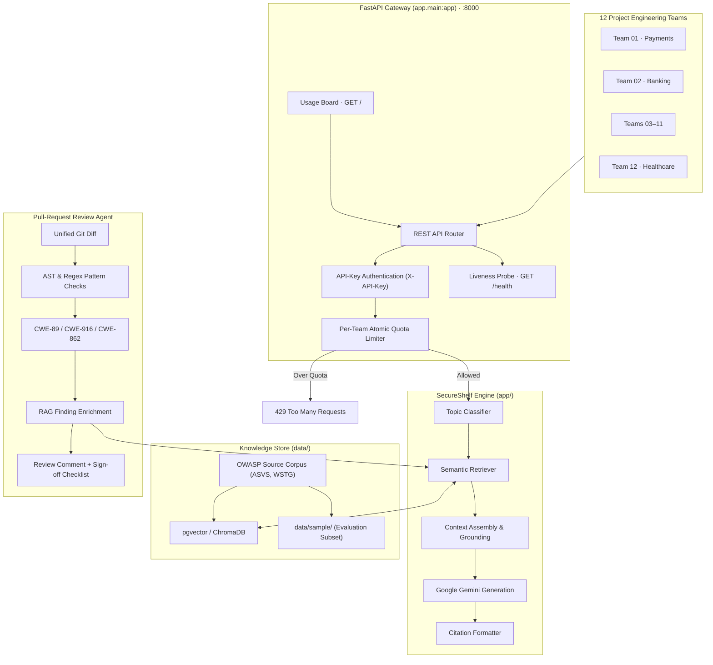
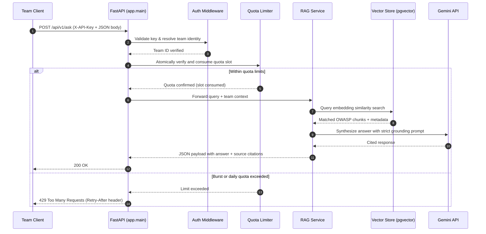
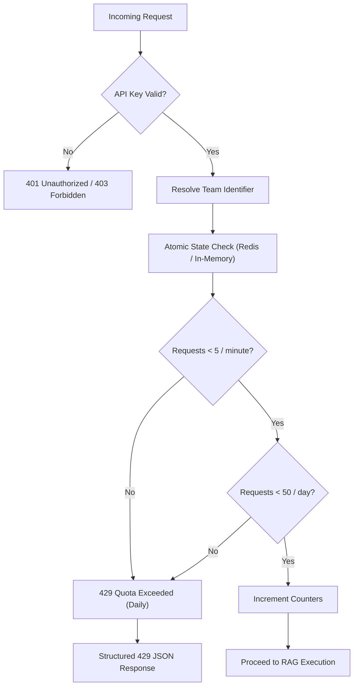
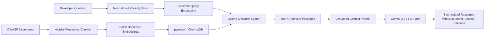
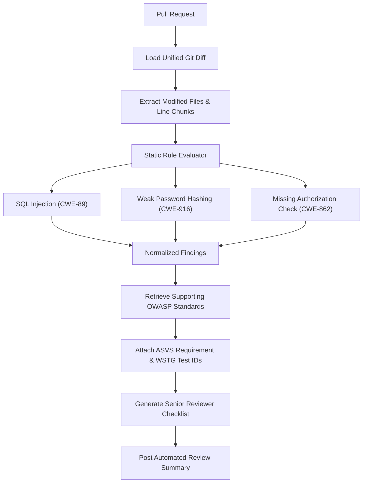
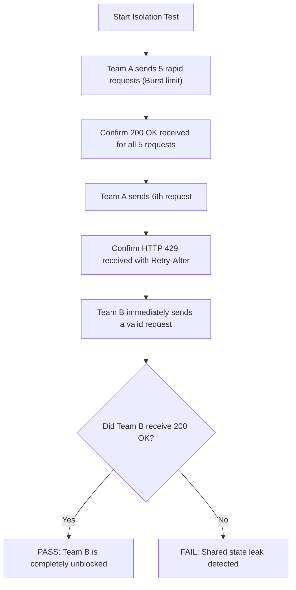

# SecureShelf

### Internal AppSec RAG Assistant · Fair-Share LLM Quotas · Pull-Request Security Reviews

> **Examate Project:** Production-grade Generative AI application providing RAG-grounded OWASP security guidance, per-team atomic quota protection, and automated pull-request security reviews for engineering organizations.

---

## Problem

Software engineering organizations struggle to apply secure-coding practices consistently across distributed product teams. Developers frequently skip consulting authoritative security documentation (such as OWASP ASVS and Cheat Sheets) due to high search friction, while shared LLM developer tooling suffers from the "noisy-neighbor" problem—where high-volume or automated requests from one team exhaust shared model quotas and starve others. SecureShelf solves this by combining retrieval-augmented generation (RAG) over verified OWASP standards, atomic per-team fair-share quota isolation, and automated pull-request diff security reviews.

## Who it is for

- **Feature Developers & Engineering Teams:** 12 project teams in Coimbatore (e.g., Payments, Banking, Healthcare) seeking immediate, grounded secure-coding answers and pre-commit diff checks without risking organization-wide rate limits.
- **Application Security (AppSec) Leads & Compliance Officers:** Security teams needing observable usage telemetry, consistent OWASP ASVS compliance verification, and standardized senior-developer review checklists.

## Signature feature

**Atomic Per-Team Fair-Share Quota Enforcement:** Independent burst (5 req/min) and daily (50 req/day) token bucket quotas keyed strictly by team identity, guaranteeing that a runaway or noisy team receives HTTP `429` responses without degrading service or depleting shared LLM token budgets for sibling teams.

## Hardest problem (my interview story)

Enforcing fair-share atomic quota limits across concurrent multi-tenant team requests without starving sibling teams or letting burst traffic bypass daily caps, while ensuring model responses remain strictly grounded with verified OWASP citations.

## Dataset

| Source | Link | Documents | Pages | Licence / terms |
|---|---|---|---|---|
| OWASP Application Security Verification Standard (ASVS v4.0.3) | [owasp.org/www-project-application-security-verification-standard](https://owasp.org/www-project-application-security-verification-standard/) | 1 specification | 76 | CC BY-SA 4.0 |
| OWASP Cheat Sheet Series | [cheatsheetseries.owasp.org](https://cheatsheetseries.owasp.org/) | 15 targeted sheets | 95 | CC BY-SA 4.0 |
| OWASP Web Security Testing Guide (WSTG v4.2) | [owasp.org/www-project-web-security-testing-guide](https://owasp.org/www-project-web-security-testing-guide/) | Selected controls | 120 | CC BY-SA 4.0 |

> Full data corpus lives in `data/raw/` (not committed). Curated evaluation samples are located in [`data/sample/`](data/sample/). See [`DATASET.md`](DATASET.md) for complete manifest and download details.

## 10 real questions

See [`docs/QUESTIONS.md`](docs/QUESTIONS.md) for the benchmark evaluation suite covering realistic developer security queries, multi-page context challenges, and out-of-scope negative assertions.

## Run it

```bash
# 1. Create and activate virtual environment
python -m venv .venv
source .venv/bin/activate       # Windows: .venv\Scripts\activate

# 2. Install dependencies
pip install -r requirements-dev.txt

# 3. Configure environment
cp .env.example .env            # Windows: copy .env.example .env

# 4. Start the FastAPI development server
uvicorn app.main:app --reload

# 5. Verify service health
curl http://localhost:8000/health
```

## Live link

*Added in Week 2* (Target: Cloud Run deployment with CI/CD).

---

## Contents

- [Highlights](#highlights)
- [System Architecture](#system-architecture)
- [Core Workflows](#core-workflows)
  - [1. Ask SecureShelf (Cited RAG)](#1-ask-secureshelf)
  - [2. Fair-Share Quota Enforcement](#2-fair-share-quota-enforcement)
  - [3. RAG Retrieval & Grounded Generation](#3-rag-retrieval-and-answer-generation)
  - [4. Pull-Request Security Review](#4-pull-request-security-review)
  - [5. Knowledge-Base Ingestion](#5-knowledge-base-ingestion)
- [Quota Policy & Response Contract](#quota-policy)
- [Technology Stack](#technology-stack)
- [Project Structure](#project-structure)
- [Getting Started & Development Workflow](#getting-started)
- [API Reference](#api-reference)
- [Testing & Verification](#testing-and-verification)
- [Security & Production Readiness](#security-and-production-readiness)
- [License and Attribution](#license-and-attribution)

---

## Highlights

| Capability | Purpose |
|---|---|
| **Team-isolated quotas** | Apply burst (5 req/min) and daily (50 req/day) limits independently to each team. |
| **AppSec RAG assistant** | Answer secure-coding questions using retrieved OWASP material with exact document and section citations. |
| **Curated knowledge corpus** | Structured ingestion pipeline for ASVS, Cheat Sheet Series, and WSTG guidance. |
| **PR-diff security checks** | Inspect unified Git diffs for SQL injection (CWE-89), weak hashing (CWE-916), and missing authorization (CWE-862). |
| **Usage & governance board** | Real-time observability over team usage, remaining quotas, and trending security topics. |
| **Fair-share verification** | Automated test suite proving a noisy team receives HTTP 429 without impacting sibling teams' allowances. |
| **Local demo mode** | Seed a small offline corpus (`data/sample/`) for testing and evaluation without full indexing overhead. |

---

## System Architecture

The architecture separates client authentication and quota enforcement from retrieval-augmented generation and static diff analysis:



### Trust Boundaries

- **Client boundary:** Team clients supply credentials via the `X-API-Key` HTTP header.
- **Quota boundary:** Authentication resolves keys to a canonical team identity before quota accounting takes place.
- **Model boundary:** Retrieved OWASP passages are treated as untrusted context, not executable system instructions. Prompts are defensively isolated against indirect prompt injection.
- **Administrative boundary:** Quota resets, load simulations, and cross-team telemetry are restricted to authenticated administrators.
- **CI boundary:** Unified diffs submitted for PR review are parsed strictly as data strings and never evaluated as code.

---

## Core Workflows

### 1. Ask SecureShelf

Developer path for submitting secure-coding queries:



### 2. Fair-Share Quota Enforcement

The limiter prevents one team from consuming shared infrastructure or LLM budgets:



### 3. RAG Retrieval and Answer Generation



### 4. Pull-Request Security Review



#### Detection Scope

| Vulnerability Type | Example Risk Pattern | CWE | Relevant OWASP Guidance |
|---|---|---|---|
| **SQL Injection** | Unparameterized string formatting / raw SQL execution | CWE-89 | ASVS V5.3.4, SQL Injection Cheat Sheet |
| **Weak Password Hashing** | MD5, SHA-1, or plain SHA-256 without salt/work factor | CWE-916 | ASVS V2.4.1, Password Storage Cheat Sheet |
| **Missing Authorization** | Unprotected state-changing endpoints or IDOR patterns | CWE-862 | ASVS V4.1.1, Authorization Cheat Sheet |

---

## Quota Policy

| Policy | Per-Team Limit | Scope & Purpose |
|---|---|---|
| **Burst limit** | 5 requests / minute | Dampens short traffic bursts and accidental loops |
| **Daily limit** | 50 requests / day | Caps daily token consumption per team |
| **Isolation** | Independent team keys | Noisy-neighbor traffic from one team cannot affect others |
| **Exceeded action** | HTTP `429` | Immediately returned without dispatching downstream LLM requests |

### Standard 429 Response Contract

```json
{
  "detail": {
    "code": "team_quota_exceeded",
    "team_id": "team-01-payments",
    "limit_type": "per_minute",
    "message": "Burst limit of 5 requests/minute exceeded for this team.",
    "retry_after_seconds": 60
  }
}
```

---

## Technology Stack

| Layer | Component | Description |
|---|---|---|
| **Web Framework** | FastAPI (>= 0.115), Uvicorn | High-performance asynchronous REST API framework |
| **Settings & Config** | Pydantic Settings (>= 2.4) | Environment variable management via `.env` |
| **LLM & Embeddings** | Google Gemini (`google-genai` / SDK) | `gemini-2.5-flash` or `gemini-1.5-flash` for reasoning & RAG generation |
| **Vector Database** | PostgreSQL + pgvector (or ChromaDB) | Vector embeddings and metadata persistence |
| **Rate Limiting** | Redis / Atomic In-Memory Limiter | Atomic per-team token bucket tracking |
| **Static PR Analysis** | Python `ast` + Regex Matcher | Unified diff security linting and pattern detection |
| **Testing & Quality** | Pytest, HTTPX, Ruff | Automated liveness, quota isolation, and lint tests |

---

## Project Structure

Aligned directly with the `genai-starter-repo` repository layout:

```text
genai-starter-repo/
├── .github/
│   └── workflows/
│       └── ci.yml                 # CI workflow running ruff lint and pytest
├── app/
│   ├── __init__.py                # App package initialization
│   ├── config.py                  # Pydantic Settings class (APP_NAME, ENVIRONMENT, API keys)
│   ├── main.py                    # FastAPI application instance, routes, and /health
│   └── schemas.py                 # Pydantic request/response models
├── data/
│   ├── raw/                       # Full OWASP source corpus (ASVS, Cheat Sheets, WSTG)
│   └── sample/                    # Sample documents for local evaluation & testing
├── docs/
│   ├── QUESTIONS.md               # 10 real developer evaluation questions
│   └── EVAL_v0.md                 # Baseline evaluation scoring report
├── tests/
│   ├── conftest.py                # Pytest fixtures and TestClient configuration
│   ├── test_health.py             # Liveness /health endpoint test
│   └── test_fair_sharing.py       # Quota isolation and multi-team rate limit tests
├── .env.example                   # Example environment configuration
├── .gitignore                     # Git ignore rules for venv, caches, and secrets
├── DATASET.md                     # Source manifest, page counts, and licensing metadata
├── Dockerfile                     # Multi-stage production container definition
├── PROGRESS.md                    # Weekly milestone tracker
├── README.md                      # Primary repository overview
├── pyproject.toml                 # Ruff and Pytest project configuration
├── requirements.txt               # Production dependencies
└── requirements-dev.txt           # Development & test dependencies (includes requirements.txt)
```

---

## Getting Started

### 1. Prerequisites

- Python 3.11 or 3.12 installed.
- Git for cloning and diff analysis.
- Valid Google Gemini API Key.

### 2. Virtual Environment Setup

**PowerShell (Windows):**
```powershell
python -m venv .venv
.\.venv\Scripts\Activate.ps1
python -m pip install --upgrade pip
pip install -r requirements-dev.txt
```

**Bash (Linux / macOS):**
```bash
python3 -m venv .venv
source .venv/bin/activate
python -m pip install --upgrade pip
pip install -r requirements-dev.txt
```

### 3. Environment Configuration

Copy the sample environment file and add your credentials:

```bash
cp .env.example .env
```

Ensure `.env` contains:

```env
APP_NAME=SecureShelf
ENVIRONMENT=local
GEMINI_API_KEY=your_gemini_api_key_here
```

### 4. Running the Development Server

```bash
uvicorn app.main:app --reload --port 8000
```

Verify that the server is responding:

- **Health check:** `curl http://localhost:8000/health`
- **Interactive OpenAPI docs:** `http://localhost:8000/docs`
- **Interactive ReDoc:** `http://localhost:8000/redoc`

---

## API Reference

| Method | Endpoint | Description | Access / Auth |
|---|---|---|---|
| `GET` | `/health` | Liveness check returning service status, app name, and environment | Public (no LLM/DB call) |
| `POST` | `/api/v1/ask` | Ask an AppSec question; returns answer grounded in OWASP with citations | Team API key in `X-API-Key` |
| `POST` | `/api/v1/chat` | Conversational multi-turn AppSec query interface | Team API key in `X-API-Key` |
| `GET` | `/api/v1/teams/usage` | Inspect usage counters, remaining quota, and request metrics across teams | Admin / Team authenticated |
| `POST` | `/api/v1/teams/{team_id}/reset` | Reset a team's burst and daily counters | Admin only |
| `POST` | `/api/v1/pr-review/scan` | Analyze a unified Git diff for CWE patterns and attach OWASP citations | Team API key in `X-API-Key` |
| `GET` | `/api/v1/pr-review/sample` | Return sample vulnerable diff for demonstration | Development / Testing |
| `GET` | `/` | AppSec usage dashboard and governance portal | Web Browser |

### Example: Ask a Security Question

```powershell
$headers = @{
    "X-API-Key" = "team-01-payments-key"
    "Content-Type" = "application/json"
}

$body = @{
    question = "How should a Python FastAPI service prevent SQL injection when using raw queries?"
} | ConvertTo-Json

Invoke-RestMethod -Method Post -Uri "http://localhost:8000/api/v1/ask" -Headers $headers -Body $body
```

---

## Testing and Verification

### 1. Run the Full Test Suite

Tests are configured in `pyproject.toml` targeting the `tests/` directory:

```bash
python -m pytest -v
```

### 2. Verify Code Formatting & Linting

```bash
ruff check .
```

### 3. Fair-Share Isolation Test Scenario

To verify that noisy-neighbor traffic does not starve sibling teams:



---

## Security and Production Readiness

- [ ] **Secrets management:** Never commit API keys or `.env` files to source control (`.gitignore` enforced).
- [ ] **Prompt injection defense:** Treat all retrieved OWASP markdown chunks and pull-request diff snippets as data, preventing instructions in diffs from overriding system behavior.
- [ ] **Atomic rate limiting:** In production multi-worker environments, utilize Redis-backed atomic Lua scripts to prevent concurrency race conditions.
- [ ] **Data minimization:** Sanitize code snippets sent to external model endpoints, masking tokens, passwords, and private company URLs.
- [ ] **Graceful degradation:** Provide informative, structured fallback answers when downstream LLM services experience latency or quota timeouts.

---

## License and Attribution

- OWASP Application Security Verification Standard (ASVS), OWASP Cheat Sheet Series, and OWASP Web Security Testing Guide (WSTG) materials are published under the **Creative Commons Attribution-ShareAlike 4.0 International (CC BY-SA 4.0)** license.
- SecureShelf application source code is provided under the terms of the project repository license.

---

<p align="center">
  <sub>SecureShelf · Internal AppSec Enablement · Secure Coding, Shared Responsibly.</sub>
</p>
